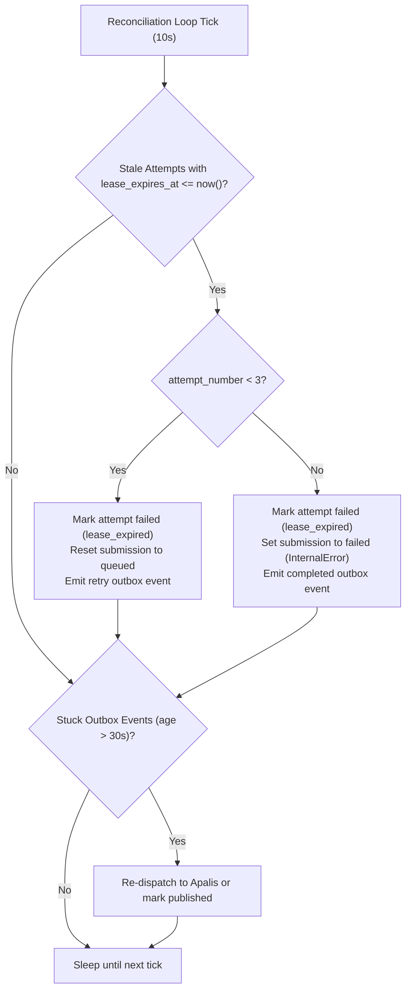

# Phase 8: Security and Reliability Hardening

Ferrum executes untrusted user-submitted code in an adversarial multi-tenant environment. Phase 8 hardens system boundaries, closes recovery windows, enforces sterile execution environments, implements active reconciliation for interrupted or orphaned workloads, and introduces operator quarantine procedures.

---

## 1. Threat Model and Boundary Verification

| Boundary | Threat Mitigation | Enforcement Mechanism |
|---|---|---|
| **Host Credentials** | Secrets, database credentials, API tokens, and private keys never enter sandboxes | `env_clear()` on supervisor process; explicit sterile environment whitelist (`PATH`, `HOME`, `TMPDIR`, `LANG`, `LC_ALL`) passed to Isolate |
| **Filesystem Isolation** | Path traversal, symlink exploitation, overwrite of reserved system files | Path component inspection rejecting `..`, `/`, and prefix traversal; strict `0o700` sandbox ownership; read-only root mounts (`/usr:norec`, `/lib:norec`) |
| **Network Egress** | Program lateral movement or outbound exfiltration | Sandbox network isolation enabled by default; no loopback or veth network namespaces allocated to box 0 |
| **Resource Exhaustion** | Fork bombs, memory bombs, unbounded file creation, infinite loops | Strict cgroup v2 memory limits (`memory.max`), PID limits (`--processes=30`), CPU time limits (`--time`), wall-clock timeouts (`--wall-time`), and output stream bounds (64 KiB) |
| **Orphaned Processes** | Unreaped background child processes outliving parent | Full cgroup subtree termination; `reap_after_error` SIGKILL process tree supervisor; post-execution verification that cgroup has zero tasks |
| **Worker Loss / Crash** | Executions frozen in `running` state with expired leases | Distributed lease protocol (30s lease, 5s heartbeat); automated background reconciliation and manual CLI recovery |
| **Cleanup Failure** | Residual processes or locked files preventing sandbox wipe | Quarantine state holding capacity (`cleanup_disposition = 'unresolved'`); operator runbook and inspection commands |

---

## 2. Sterile Process Environment

Untrusted user code executed in both the compilation and runtime stages runs with a strictly sanitized environment:

```text
PATH=/usr/local/bin:/usr/bin:/bin
HOME=/box
TMPDIR=/box
LANG=C.UTF-8
LC_ALL=C.UTF-8
```

All host environment variables—including `FERRUM_DATABASE_URL`, `DATABASE_URL`, worker authentication tokens, and infrastructure endpoints—are completely stripped.

---

## 3. Filesystem and Multi-File Traversal Protection

Staged source files, headers, and standard inputs must pass strict path validation before being written to disk:

- Absolute paths starting with `/` or Windows drive prefixes are rejected.
- Directory traversal components (`..`) and empty paths are rejected with `SandboxError::Stage`.
- Intermediate directories are created with restricted `0o700` worker-only permissions.
- Symlinks to targets outside the sandbox workspace are disallowed.

---

## 4. Active Stale Lease and Outbox Reconciliation

### Attempt Lease Protocol

- Each running attempt reserves a 30-second lease in PostgreSQL.
- The worker refreshes the lease every 5 seconds.
- If a worker dies or is network-partitioned, the lease expires.

### Background Reconciliation Loop

A background task runs in `ferrum-worker` every 10 seconds:



---

## 5. Sandbox Cleanup Quarantine

If Isolate cleanup fails due to unreleased mount points or lingering processes:

1. The execution result is safely committed to PostgreSQL.
2. The attempt record is updated:
   - `cleanup_disposition = 'unresolved'`
   - `cleanup_error = '<error message>'`
   - `cleanup_recovered_at = NULL`
3. Capacity is held in quarantine to prevent contaminating future workloads.
4. The worker daemon triggers quarantine alerting.

### Operator CLI Subcommands

Operators can manage reconciliation and quarantine from any node with database connectivity:

```bash
# Run manual reconciliation of stale leases and stuck outbox events
ferrum-worker reconcile

# List all active sandboxes currently held in quarantine
ferrum-worker quarantine list

# Resolve a specific attempt quarantine after verifying host cleanup
ferrum-worker quarantine resolve <attempt_id>

# Resolve all quarantined attempts for a restored worker host
ferrum-worker quarantine resolve-host <host_id>
```

---

## 6. Operational Runbooks

Full step-by-step operator guides are documented in:

- [Stuck executions and expired leases](runbooks/stuck-executions-and-leases.md)
- [Sandbox cleanup quarantine handling](runbooks/sandbox-cleanup-quarantine.md)
- [Outbox and dispatch recovery](runbooks/outbox-and-dispatch-recovery.md)
- [Isolation incident containment and fencing](runbooks/isolation-incident-containment.md)

---

## 7. Verification and Acceptance Matrix

Run the Phase 8 test suite:

```bash
# Test with PostgreSQL and sandbox test-double:
python3 tests/phase8/security-adversarial-smoke.py

# Test with live Isolate sandboxes on qualified Debian 13 amd64 or arm64 host:
python3 tests/phase8/security-adversarial-smoke.py --isolate
```
