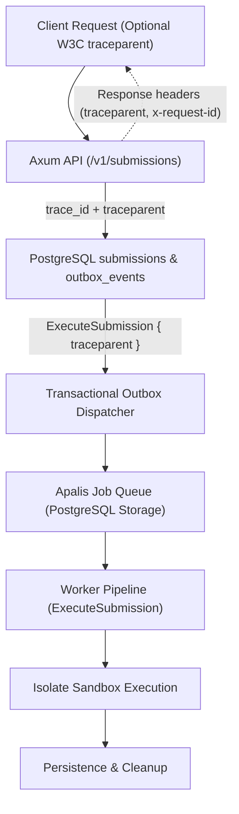

# Phase 9: Observability and Performance

Ferrum executes untrusted code in a multi-tenant environment where latency, resource bounds, isolation guarantees, and failure modes must be continuously observable. Phase 9 implements end-to-end tracing, low-cardinality Prometheus metrics, structured logs with strict redaction, operational Grafana dashboards, automated alerting connected to runbooks, and repeatable load-testing benchmarks.

---

## 1. End-to-End Trace Propagation

Ferrum adheres to the **W3C TraceContext** standard (`00-{trace_id}-{parent_id}-{trace_flags}`).



### Trace Header Lifecycle

1. **Intake Extraction:** The API inspects incoming HTTP requests for `traceparent` (and `X-Request-Id`). If absent or malformed, a fresh cryptographically random 128-bit trace ID and 64-bit root span ID are generated.
2. **Response Echoing:** The API echoes `traceparent: 00-{trace_id}-{span_id}-01` and `x-request-id: {trace_id}` in all HTTP responses.
3. **Database Durability:** Migration `0006_observability_traces.sql` adds `traceparent` columns to both `submissions` and `outbox_events` tables.
4. **Queue Propagation:** The outbox dispatcher transfers the traceparent inside the serialized `ExecuteSubmission` contract.
5. **Worker Span Entry:** The worker creates an active `worker.execute` span with `trace_id`, attributing all compiler, runtime, persistence, and cleanup events to the original caller trace.

---

## 2. Structured Log Redaction Policy

To prevent sensitive information disclosure, all structured logs follow strict security redaction:

| Data Type | Policy | Implementation |
|---|---|---|
| **Source Code** | **Never logged** | Only byte lengths recorded (`source_bytes`) |
| **Standard Input** | **Never logged** | Only byte lengths recorded (`stdin_bytes`) |
| **Standard Output / Error** | **Never logged in traces/metrics** | Stored in PostgreSQL bounded tables; only byte lengths and exit codes logged |
| **API Tokens & Secrets** | **Redacted** | `redact_secret` masks all except first 4 characters (`ferr[REDACTED]`) |
| **Correlation IDs** | **Approved** | `trace_id`, `submission_id`, `attempt_id`, and `worker_id` are permitted in logs and trace attributes |

---

## 3. Prometheus Metrics Dictionary

All metrics are exported via `GET /metrics` in Prometheus / OpenMetrics 0.0.4 text format. Metric labels are strictly low-cardinality; **submission IDs, attempt IDs, and tenant IDs are never used as labels**.

### 3.1 API & Ingress Metrics

| Metric Family | Type | Labels | Description |
|---|---|---|---|
| `ferrum_http_requests_total` | Counter | `method`, `path`, `status` | Total HTTP requests processed |
| `ferrum_http_request_duration_seconds` | Histogram | `method`, `path`, `status` | HTTP request duration in seconds |
| `ferrum_api_auth_failures_total` | Counter | `reason` | Authentication rejections (`missing_token`, `invalid_dev_token`, `invalid_api_key`) |
| `ferrum_api_rate_limit_rejections_total` | Counter | `reason` | Quota rejections (`concurrency_quota`) |
| `ferrum_submissions_created_total` | Counter | `language` | Total accepted submissions by language |

### 3.2 Queue & Dispatcher Metrics

| Metric Family | Type | Labels | Description |
|---|---|---|---|
| `ferrum_outbox_events_total` | Counter | `event_type`, `status` | Outbox events processed by status |
| `ferrum_outbox_dispatch_duration_seconds` | Histogram | *none* | Duration of outbox dispatch transaction cycles |
| `ferrum_outbox_oldest_event_age_seconds` | Gauge | *none* | Age in seconds of oldest unpublished outbox event |
| `ferrum_outbox_unpublished_count` | Gauge | *none* | Number of unpublished outbox events |
| `ferrum_reconciliation_runs_total` | Counter | `target` | Total reconciliation loop cycles (`stuck_outbox`, `stale_attempts`) |
| `ferrum_reconciled_items_total` | Counter | `target` | Total items recovered by background reconciliation |

### 3.3 Worker & Execution Pipeline Metrics

| Metric Family | Type | Labels | Description |
|---|---|---|---|
| `ferrum_worker_active_executions` | Gauge | *none* | Currently active running executions on this worker host |
| `ferrum_worker_capacity_reserved_slots` | Gauge | *none* | Current execution slots reserved by worker |
| `ferrum_worker_capacity_quarantined_slots` | Gauge | *none* | Execution slots currently locked in quarantine |
| `ferrum_stage_duration_seconds` | Histogram | `stage` | Latency decomposition (`admission`, `execute`, `persistence`) |
| `ferrum_sandbox_cleanups_total` | Counter | `disposition` | Sandbox cleanup outcomes (`verified`, `not_needed`, `unresolved`) |
| `ferrum_sandbox_quarantines_total` | Counter | *none* | Sandbox cleanups resulting in quarantine |
| `ferrum_execution_cpu_time_milliseconds` | Histogram | *none* | CPU time consumed by untrusted code |
| `ferrum_execution_wall_time_milliseconds` | Histogram | *none* | Wall time consumed by untrusted code |
| `ferrum_execution_peak_memory_kibibytes` | Histogram | *none* | Peak cgroup memory usage in KiB |
| `ferrum_execution_limit_violations_total` | Counter | `limit_type` | Limit exceeded counts (`cpu_time`, `wall_time`, `memory`, `stdout`, `stderr`) |

### 3.4 Database & Infrastructure Metrics

| Metric Family | Type | Labels | Description |
|---|---|---|---|
| `ferrum_database_connections_active` | Gauge | *none* | Active pooled connections to PostgreSQL |
| `ferrum_database_connections_idle` | Gauge | *none* | Idle connections in PostgreSQL pool |

---

## 4. Grafana Dashboards Inventory

Production dashboards are provisioned in `deployment/grafana/dashboards/`:

1. **`platform-overview.json`:** Executive and operational overview showing ingestion rate, latency quantiles (p50/p95/p99), outbox backlog age, and worker slot allocation.
2. **`queue-and-workers.json`:** Queue age, outbox dispatch throughput, admission wait latency, and background reconciliation activity.
3. **`sandbox-and-execution.json`:** Stage latency breakdown, sandbox cleanup verification rates, limit violations, and CPU/memory distributions.
4. **`language-and-verdict.json`:** Submissions, compilation durations, compilation failures, and judging verdict distributions across all supported languages.
5. **`security-and-reliability.json`:** Active quarantined sandboxes, API authentication failures, rate limit enforcement, stale lease expirations, and PostgreSQL pool saturation.

---

## 5. Alerting Matrix & Runbook Integration

Alert rules are defined in `deployment/prometheus/alerts.yml` and directly reference operational runbooks:

| Alert Name | Expression / Condition | Severity | Assigned Owner | Connected Runbook |
|---|---|---|---|---|
| `FerrumOutboxDispatchBacklog` | `oldest_event_age > 30s` for 15s | Critical | `platform-oncall` | [Outbox and Dispatch Recovery](runbooks/outbox-and-dispatch-recovery.md) |
| `FerrumSandboxCleanupQuarantined` | `quarantined_slots > 0` for 10s | Warning | `sandbox-oncall` | [Sandbox Cleanup Quarantine](runbooks/sandbox-cleanup-quarantine.md) |
| `FerrumWorkerCapacityExhausted` | `reserved_slots >= 1` for 30s | Warning | `capacity-oncall` | [Stuck Executions and Leases](runbooks/stuck-executions-and-leases.md) |
| `FerrumPlatformHighFailureRate` | `5xx_error_rate > 5%` for 30s | Critical | `api-oncall` | [Isolation Incident Containment](runbooks/isolation-incident-containment.md) |
| `FerrumStuckAttemptsDetected` | `reconciled_stale_attempts > 0` | Warning | `reliability-oncall` | [Stuck Executions and Leases](runbooks/stuck-executions-and-leases.md) |
| `FerrumQueueLatencyHigh` | `p95_queue_wait > 5.0s` for 1m | Warning | `queue-oncall` | [Outbox and Dispatch Recovery](runbooks/outbox-and-dispatch-recovery.md) |

---

## 6. Verification & Staged Load Testing

The smoke test harness in `tests/phase9/load-and-metrics-smoke.py` checks the API metrics endpoint, HTTP trace headers, and the worker metrics CLI against disposable PostgreSQL.

```bash
python3 tests/phase9/load-and-metrics-smoke.py
python3 tests/phase9/load-and-metrics-smoke.py --count 100
```

The harness sends sequential requests in stages of up to 25. It cancels the submissions through the API after each stage to free capacity under the tenant quota. Reported throughput and percentiles cover intake and exclude cancellation time. Worker throughput and end-to-end latency require a separate run on a qualified Linux worker.

Verify the Prometheus API failure-rate alert with synthetic request counters:

```bash
docker run --rm --network none --cap-drop ALL --security-opt no-new-privileges \
  --entrypoint /bin/promtool \
  --mount "type=bind,src=$PWD/deployment/prometheus,dst=/rules,readonly" \
  prom/prometheus:v3.2.1 test rules /rules/alerts.test.yml
```

### Verification Evidence

- **Metric Scrapes:** 30 metric families verified on `GET /metrics`.
- **Trace Propagation:** W3C `traceparent` and `x-request-id` verified over HTTP.
- **Worker CLI:** `ferrum-worker metrics` command validated.
- **Synthetic Load:** The harness reports intake throughput and latency for a multi-language request mix.
- **Post-Load State:** The submission counter and HTTP request duration histogram are exposed.

For detailed hardware profiles and measured stage breakdowns, see the [Capacity Benchmark Report](capacity-report.md).
